# Password Cracking Lab — Cracking Protected PDFs with John the Ripper

This repository documents a hands-on lab exercise focused on **password recovery / password cracking fundamentals**, using password-protected PDF files as the target. The goal was to understand how password hashes are extracted from protected documents and how dictionary attacks can recover the original password.

> ⚠️ **Educational purpose only.** This lab was completed using sample files provided for a cybersecurity training course (Networkwalks Academy). The techniques shown here should only be used on files/systems you own or have explicit permission to test.

## Project Overview

| | |
|---|---|
| **Topic** | Password cracking fundamentals |
| **Target files** | 3x password-protected PDFs (`My Locked PDF1.pdf`, `My Locked PDF2.pdf`, `My Locked PDF3.pdf`) |
| **Tools used** | [John the Ripper](https://www.openwall.com/john/) + Johnny (GUI front-end), `pdf2john`, browser-based hash/dictionary-attack simulator |
| **Attack type** | Dictionary attack |
| **Outcome** | All 3 PDFs successfully unlocked; challenge "flags" captured from each |

## Tools Used

- **John the Ripper (JtR)** — the core password-cracking engine, which hashes words from a wordlist and compares them to the target hash.
- **Johnny** — a graphical front-end for John the Ripper, used here to load the password hash, run the attack, and view cracked results in a table (User / Password / Hash / Format).
- **pdf2john** — utility used to extract a crackable hash from an encrypted PDF (in `$pdf$...` format compatible with John/Hashcat).
- **Hash Calculator (web tool)** — browser-based tool to upload a locked PDF and extract its `$pdf$` hash, confirming revision/version/key length (R4, V4, 128-bit in this case).
- **Password Cracker (dictionary-attack simulator)** — a browser-based visualization of the same dictionary-attack concept John the Ripper uses: it hashes each word in a wordlist and checks for a match against the extracted PDF hash.

## Methodology

1. **Identify the target** — Each PDF was protected with an owner/user password, preventing it from being opened.
2. **Extract the hash** — Used the Hash Calculator tool (and `pdf2john` logic) to pull out a crackable hash from the PDF, e.g.:
   ```
   $pdf$4*4*128*-1028*1*16*<hash data>...
   ```
   This confirmed each file's encryption revision (R4), version (V4), and key length (128-bit).
3. **Run a dictionary attack**:
   - **Via Johnny/John the Ripper**: loaded the password hash file, started a new attack, and let John iterate through its wordlist until a match was found.
   - **Via the browser simulator**: pasted the extracted hash and ran the same dictionary-attack logic, watching each candidate word get tried in real time until a match ("MATCH ✓") appeared.
4. **Verify the password** — Opened each PDF using the cracked password to confirm it worked and to retrieve the flag printed inside.

## Results

| PDF File | Hash Revision | Cracked Password | Flag Captured |
|---|---|---|---|
| `My Locked PDF1.pdf` | R4 / V4 / 128-bit | `good-luck` | `nw{cybersecurity_flag_captured_2608}` |
| `My Locked PDF2.pdf` | R4 / V4 / 128-bit | `password1` | `nw{networkwalks_persistence_jtr_270521}` |
| `My Locked PDF3.pdf` | R4 / V4 / 128-bit | `1qaz2wsx` | `nw{networkwalks_flag_260821_1}` |

All three passwords were recovered purely through **dictionary attacks** — no brute-forcing of the full keyspace was needed, which highlights how weak/common passwords (`password1`, `1qaz2wsx`, `good-luck`) are trivial to crack once an attacker has the hash.

## Screenshots

### Hash extraction (Hash Calculator tool)

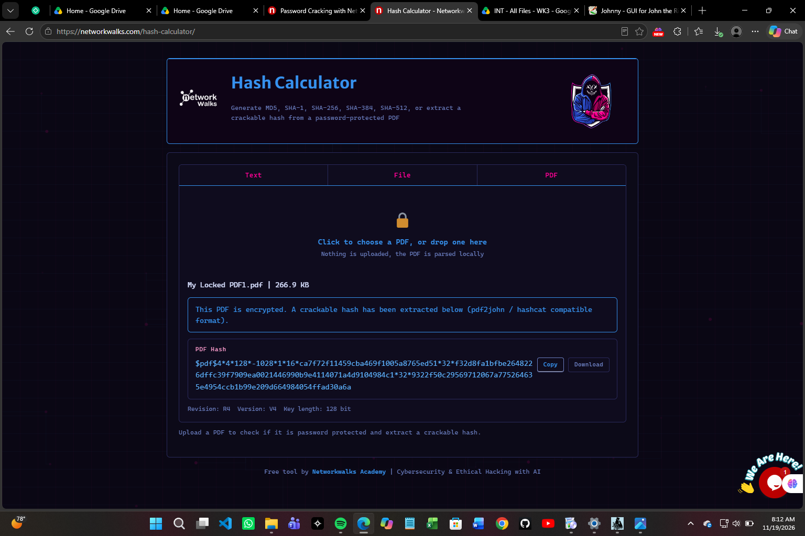
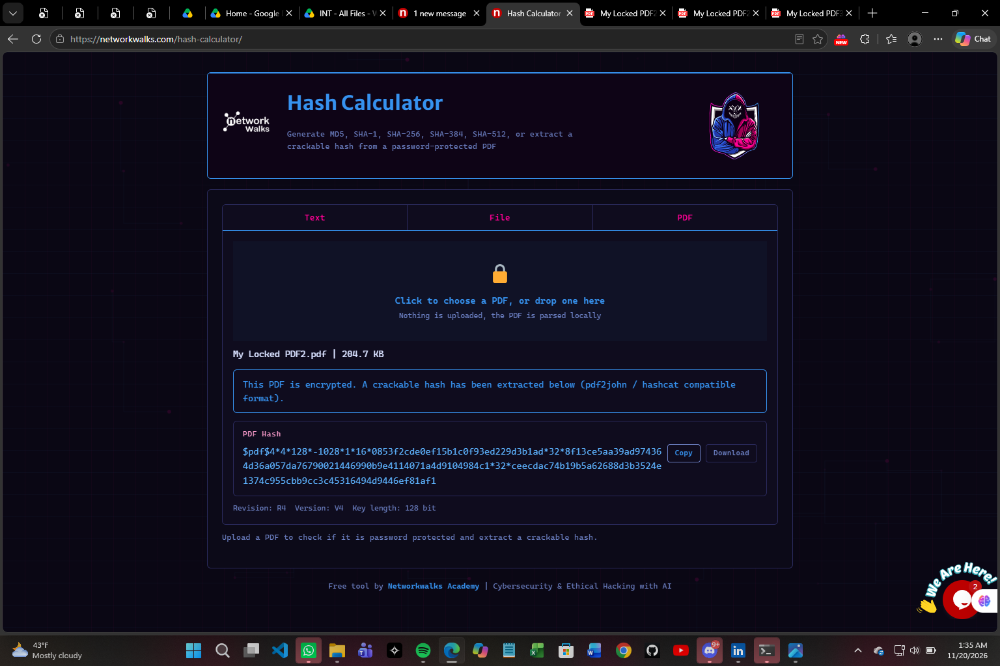

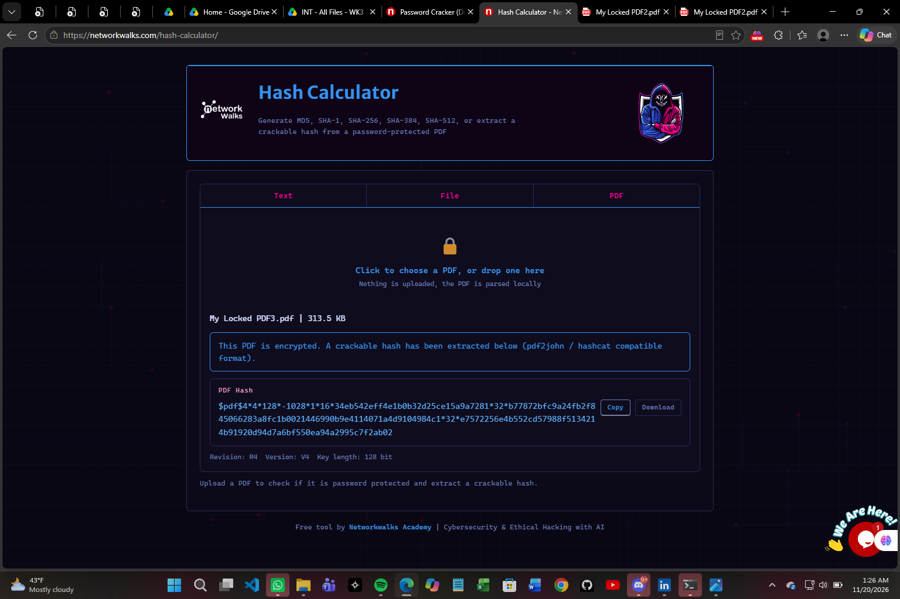

### Dictionary attack in Johnny (GUI for John the Ripper)
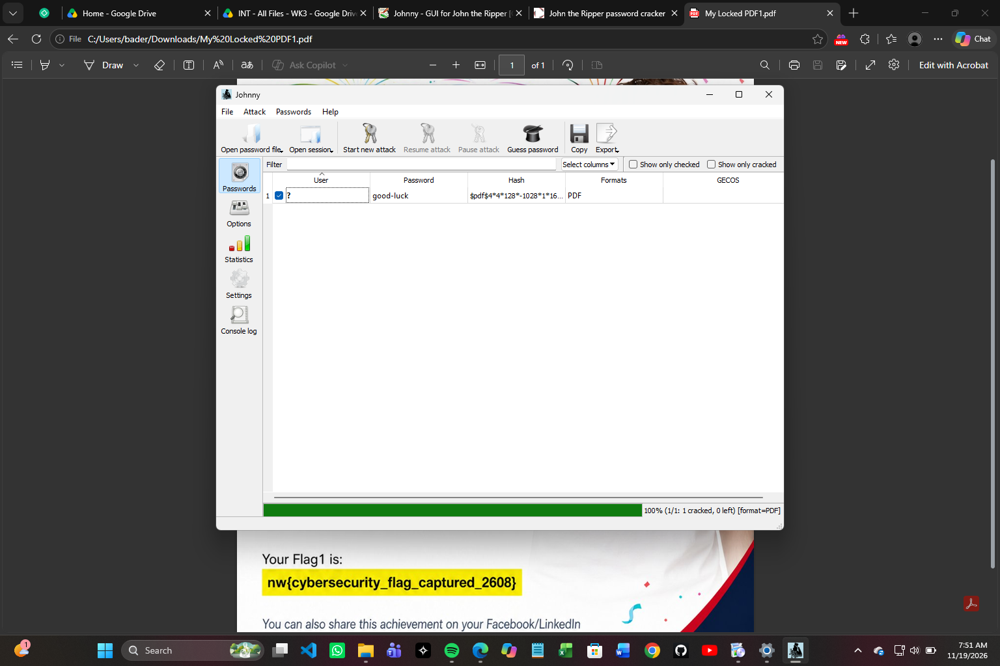
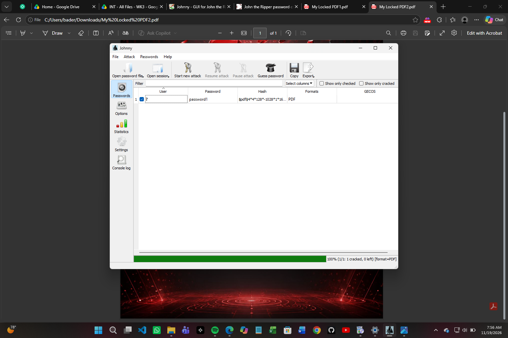
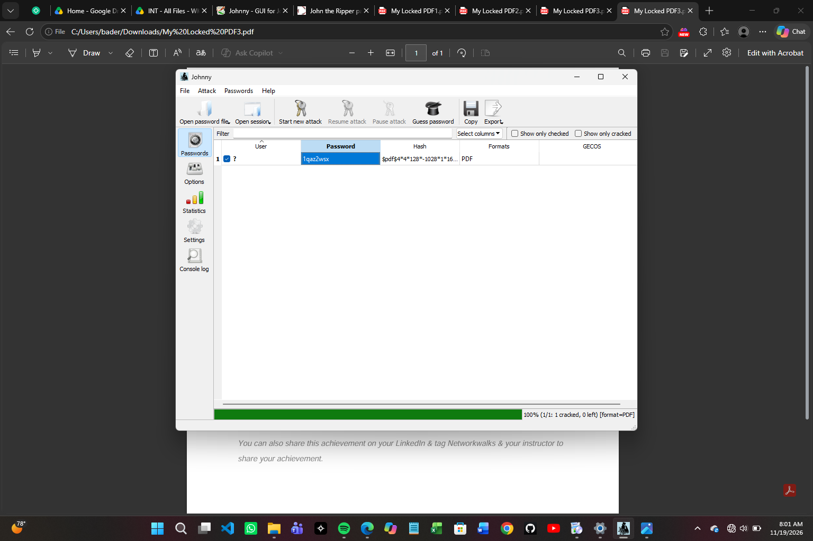

### Browser-based dictionary attack simulator
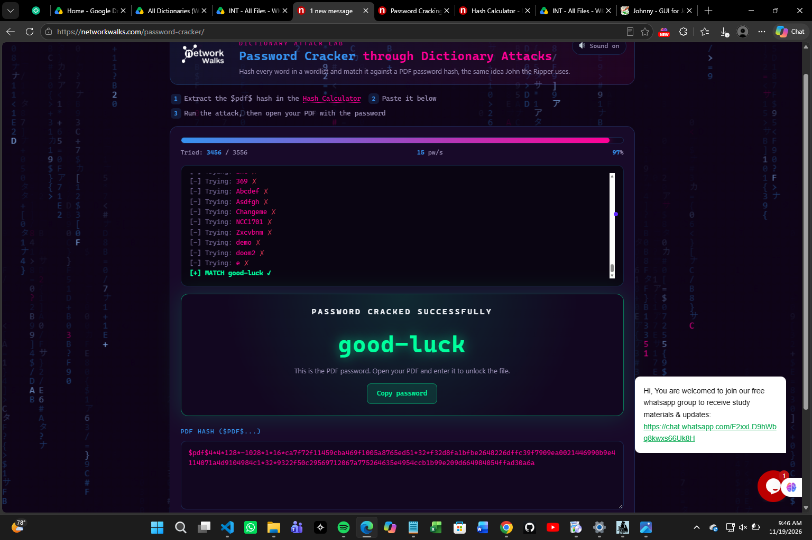
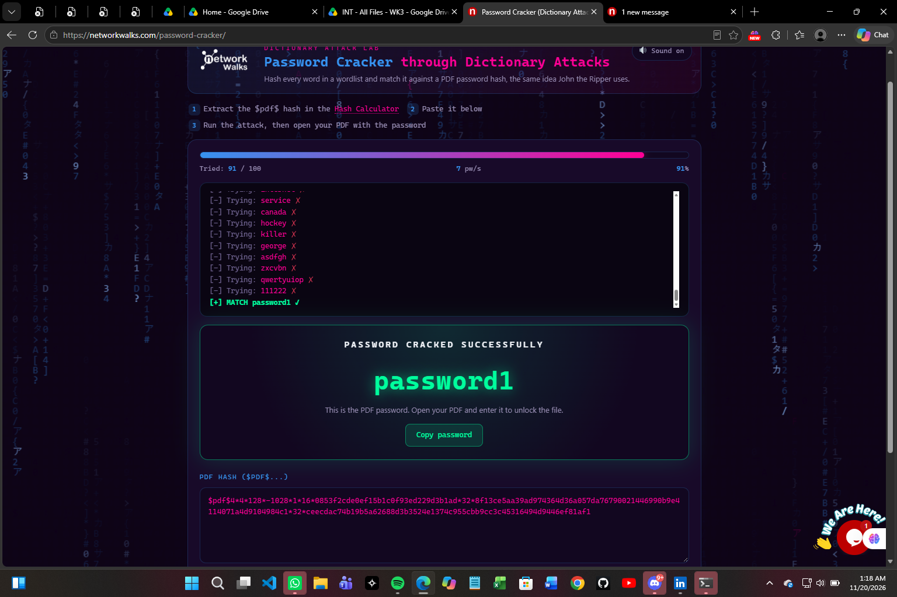
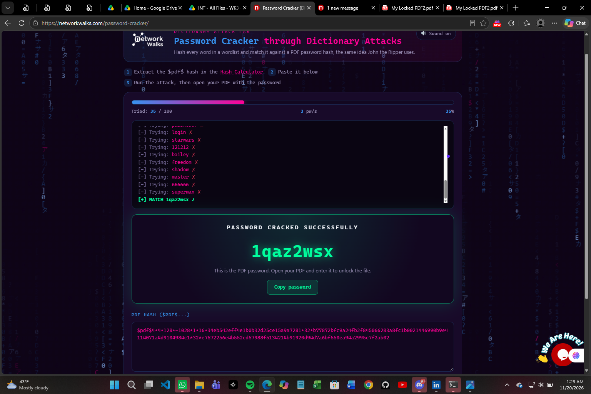

### Unlocked PDFs with captured flags

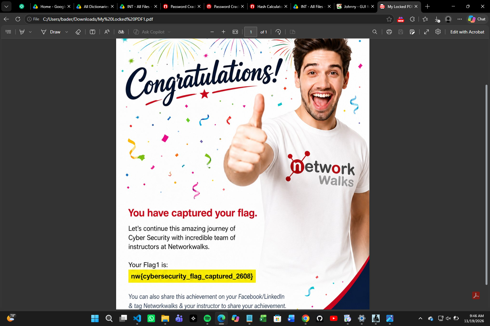
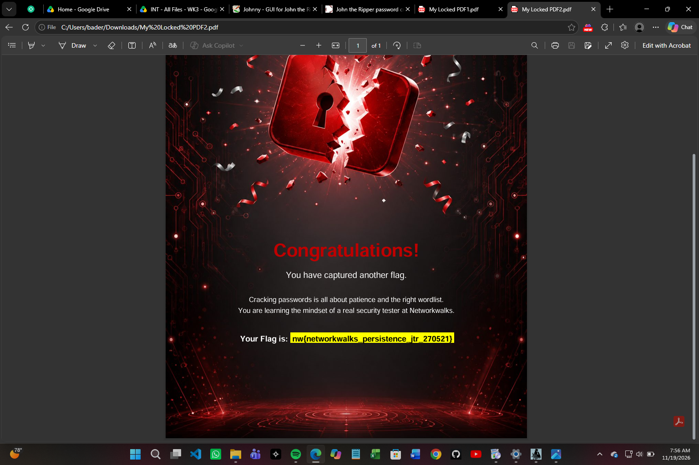
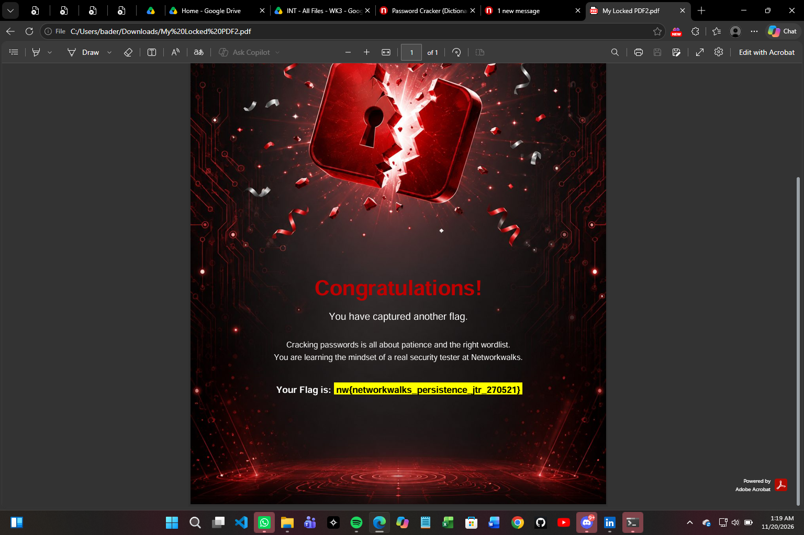


## Key Takeaways

- **Weak passwords are the real vulnerability**, not the encryption algorithm — all three passwords were common/simple strings that a small wordlist cracked in seconds.
- **Hash extraction is a prerequisite step**: tools like `pdf2john` convert a document's encryption metadata into a hash format that cracking tools can actually attack.
- **Dictionary attacks are fast and effective** against predictable passwords, which is why security guidance always pushes for long, random, unique passwords (or passphrases) that won't appear in common wordlists.
- **GUI tools like Johnny** make it easier to visualize what John the Ripper is doing under the hood (list of candidate passwords, hash comparisons, success state) compared to the command line.

## Disclaimer

This project was completed as part of a structured cybersecurity training exercise using provided sample files. Do not use these techniques against documents, systems, or accounts without proper authorization — unauthorized password cracking is illegal in most jurisdictions.
